# Syncthing Conflict Resolver

Плагин Obsidian для разбора конфликтов Syncthing. Конфликты сверяются бок о бок, как в pull request: **текущая версия | результат | конфликтная копия**. Работает на компьютере, Android и iOS.

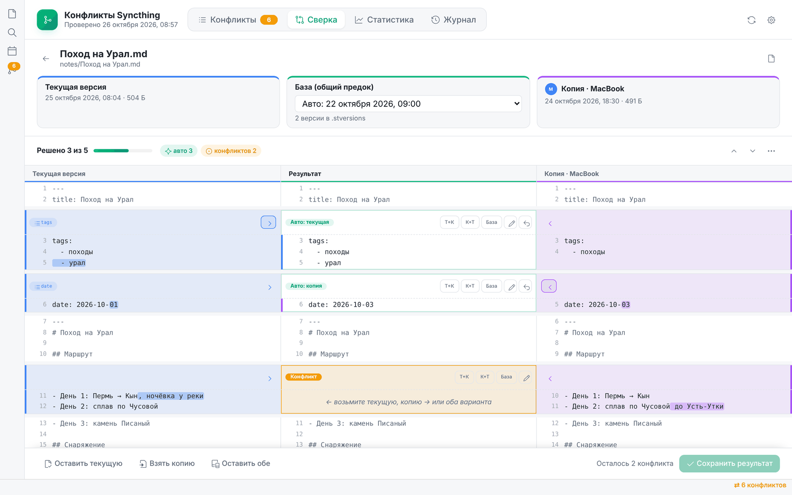

**Содержание:** [Возможности](#возможности) · [Установка](#установка) · [Быстрый старт](#быстрый-старт) · [Умный разбор](#умный-разбор-тысячи-конфликтов) · [Новое устройство без конфликтов](#как-подключать-новое-устройство-без-лавины-конфликтов) · [Сверка](#сверка) · [Картинки и удалённые файлы](#картинки-и-удалённые-файлы) · [Статистика и журнал](#статистика-и-журнал) · [Папки на устройстве](#папки-на-устройстве) · [На телефоне](#на-телефоне) · [Настройки](#настройки) · [Откуда берётся база](#откуда-берётся-база) · [Вопросы](#частые-вопросы) · [Устройство кода](#устройство-кода)

---

## Возможности

- **Умный разбор тысяч конфликтов.** Каждая копия получает категорию: идентичная, невидимые отличия, только свойства, копия устарела или новее, сливается сама, настоящий конфликт. Всё, что разбирается без потери данных, решается одной кнопкой.
- **Находит все конфликты.** Ищет файлы `*.sync-conflict-*` в хранилище и, при желании, в папке `.obsidian`. Копии группируются по исходному файлу, у каждой видно, с какого устройства и когда она пришла.
- **Трёхстороннее слияние.** Если в Syncthing включено версионирование, плагин находит в `.stversions` версию до конфликта и использует её как общего предка. Правки, сделанные только с одной стороны, сливаются сами, вручную остаются только настоящие пересечения.
- **Свойства по ключам.** Frontmatter сравнивается по каждому свойству отдельно: правка `tags` на телефоне и правка `date` на компьютере не конфликтуют.
- **Пословная подсветка** отличий, свёртка неизменённых участков, переход между конфликтами.
- **Решение по каждому блоку:** взять текущую версию, копию, обе в любом порядке, вернуть базу или поправить руками.
- **Картинки и двоичные файлы** сравниваются целиком: оставить одну версию или сохранить обе.
- **Исходный файл удалён, а копия осталась** — копию можно восстановить или удалить.
- **Идентичные копии** (совпадают байт в байт) убираются одной кнопкой.
- **Массовые действия** над выбранными копиями.
- **Статистика:** график по дням, устройства, папки, самые конфликтные файлы, время до решения. Отчёт можно сохранить в заметку.
- **Журнал** всех решений.
- **Папки на устройстве** помимо хранилища: на компьютере и, в экспериментальном режиме, на Android. У каждой папки есть проверка доступа.
- **Значок на ленте** со счётчиком конфликтов и быстрым меню.
- **Светлая и тёмная тема**, раскладка для телефона.

## Установка

Для работы нужны только три файла: `main.js`, `manifest.json` и `styles.css`. Положите их в `<хранилище>/.obsidian/plugins/syncthing-conflict-resolver/`. Можно скопировать и всю папку целиком, тогда README в настройках будет со скриншотами.

```
.obsidian/plugins/syncthing-conflict-resolver/
  main.js          ← все модули уже внутри
  manifest.json
  styles.css
  README.md        (необязательно)
  screenshots/     (необязательно)
  src/             (необязательно — исходники для правок)
```

Затем откройте **Настройки → Сторонние плагины**, нажмите ⟳ («Перезагрузить плагины») и включите **Syncthing Conflict Resolver**.

> Папка `.obsidian` скрытая. На macOS её показывает `Cmd + Shift + .`

Ваш установщик, который переносит только эти три файла, подходит: `main.js` самодостаточный.

**На телефон** плагин попадёт сам: `.obsidian/plugins` синхронизируется через Syncthing вместе с хранилищем. Останется включить его в настройках Obsidian на телефоне.

## Быстрый старт

Плагин открывается несколькими способами:

- значок на **левой вертикальной ленте**, на нём виден счётчик открытых конфликтов;
- **правый клик по значку** открывает быстрое меню;
- надпись «⇄ N конфликтов» в строке состояния;
- команда **«Открыть конфликты»** (`Ctrl/Cmd + P`);
- правый клик по файлу → **«Сверить конфликт Syncthing»**.

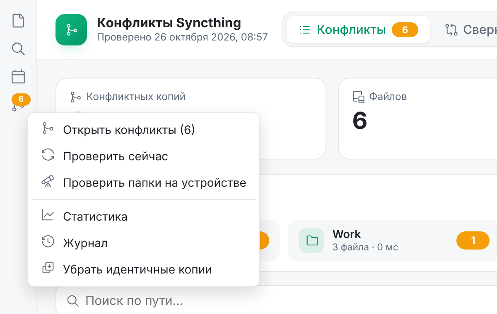

> Если значка на ленте нет, включите его: **Настройки → Внешний вид → Лента → Управление**. На телефоне значки ленты собраны в меню ☰.

На вкладке **Конфликты** собрана сводка, полоса проверенных папок, фильтры и карточки файлов с копиями. Нажмите **Сверить** у нужной копии.

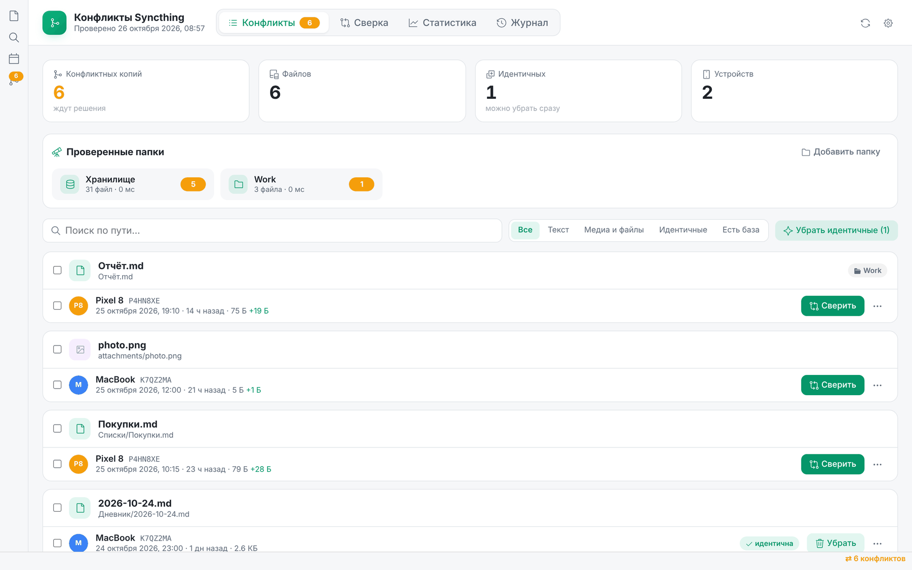

Клик по папке в полосе «Проверенные папки» оставляет в списке только её конфликты. Флажки слева включают массовые действия: «Оставить текущие», «Взять копии», «Оставить обе».

## Умный разбор: тысячи конфликтов

После первой синхронизации нового устройства конфликтных копий могут оказаться тысячи, причём почти все совпадают с файлами байт в байт. Разбирать их по одной не нужно: плагин сам читает каждую копию и раскладывает их по категориям.

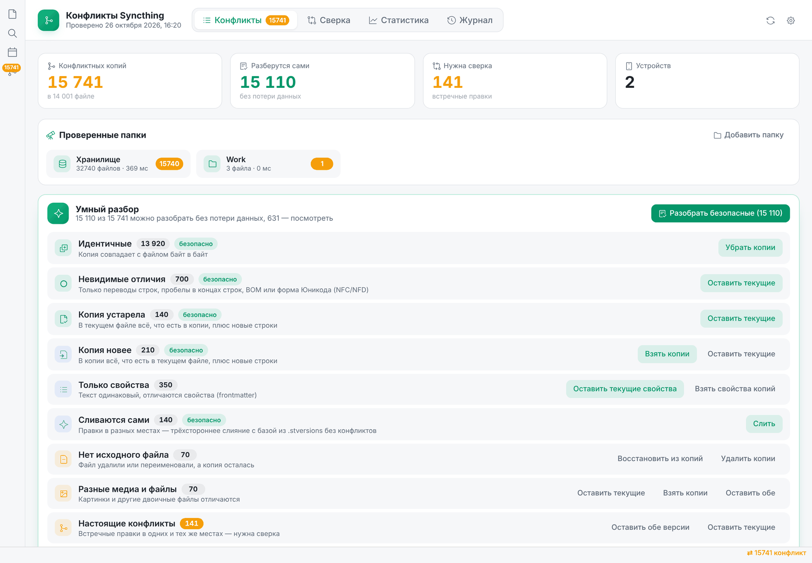

| Категория | Что значит | Что делает кнопка |
|---|---|---|
| **Идентичные** | Копия совпадает байт в байт | Убрать копии |
| **Невидимые отличия** | Только переводы строк (CRLF/LF), пробелы в концах строк, BOM, неразрывные пробелы, форма Юникода NFC/NFD (частая история macOS ↔ Android с кириллицей «й», «ё») | Оставить текущие |
| **Копия устарела** | В текущем файле всё, что в копии, плюс новые строки | Оставить текущие |
| **Копия новее** | В копии всё, что в текущем файле, плюс новые строки | Взять копии |
| **Сливаются сами** | Правки в разных местах, база из `.stversions` есть | Слить |
| **Только свойства** | Текст одинаковый, отличаются свойства | Оставить текущие / взять свойства копий |
| **Нет исходного файла** | Файл удалён, копия осталась, переименованного файла не нашлось | Восстановить / удалить |
| **Разные медиа и файлы** | Картинки и прочие файлы отличаются | Оставить текущие / взять копии / оставить обе |
| **Настоящие конфликты** | Встречные правки в одних и тех же строках | Оставить обе / оставить текущие / сверить по одной |

**Переименованные файлы.** Syncthing видит переименование как «удалить старый файл + создать новый». Если на другом устройстве в это время меняли файл со старым именем, правка сохраняется конфликтной копией со *старым* именем, а исходного файла под ним уже нет. Плагин ищет такой файл под новым именем: сначала по похожему имени (`2026-10-01_09-04-28.md` → `2026-10-01 09-04-28.md` — пробелы, `_`, `-` и регистр не важны), потом по содержимому. Если нашёл, копия сравнивается с новым файлом и попадает в обычную категорию («Идентичные», «Копия устарела» и т. д.), а у файла появляется плашка «было: старое имя». Восстанавливать старое имя и плодить дубли не нужно. Файл с тем же именем в другой папке, но с другим текстом, плагин за переименование не считает.

Кнопка **«Разобрать безопасные»** проходит первые пять категорий подряд: в каждом случае остаётся версия, в которой есть всё. Клик по категории показывает её копии в списке, а у каждой категории есть свои кнопки. Ход анализа и разбора виден на полосе прогресса, процесс можно остановить в любой момент.

Список показывает по 50 файлов, дальше — «Показать ещё», поэтому окно не тормозит даже на десятках тысяч копий. Журнал и статистика при массовом разборе пишут одну сводную запись на пачку, а не тысячи.

> **Совет.** Перед массовым разбором на компьютере выберите в настройках «Куда девать конфликтную копию» → **Системная корзина**. Иначе тысячи копий окажутся в `.trash` внутри хранилища, и Syncthing разнесёт их по всем устройствам.

## Как подключать новое устройство без лавины конфликтов

Массовые конфликты почти всегда появляются при **первой синхронизации** папки с устройством, на котором файлы уже были. Так бывает, если хранилище скопировали заранее, на устройстве осталась старая копия или Obsidian на нём открыли и начали писать в файлы до конца синхронизации. У Syncthing ещё нет общей истории версий с этим устройством, поэтому любой файл, который выглядит изменённым с обеих сторон, становится конфликтом. Иногда изменённым его делает всего лишь время изменения или перевод строки, даже если на вид содержимое не менялось.

Порядок без конфликтов:

1. **На новом устройстве начинайте с пустой папки**, если это возможно, и дождитесь, пока Syncthing скачает всё.
2. **Если файлы на новом устройстве уже есть**, добавьте папку на нём с типом **«Только приём»** (Receive Only). Локальные отличия тогда не превращаются в конфликтные копии: Syncthing помечает их как «изменено локально» и даёт кнопку **«Отменить локальные изменения»**. После полной синхронизации («Актуально») переключите папку на «Отправка и приём».
3. **Не открывайте Obsidian на новом устройстве**, пока синхронизация не закончится. Obsidian и плагины пишут в файлы при запуске: `workspace.json`, пересчёт ссылок, обновление свойств.
4. Добавьте в `.stignore` то, что не нужно синхронизировать: `.obsidian/workspace*.json`, `.trash`.

Если конфликты всё же появились, откройте плагин, дождитесь конца анализа и нажмите **«Разобрать безопасные»**. Остаток разберите по категориям.

## Сверка

Три колонки: слева **текущая версия** (синяя), справа **конфликтная копия** (фиолетовая), посередине **результат**. Отличия подсвечены по словам.

Блоки бывают трёх видов:

| Метка | Что значит |
|---|---|
| **Авто: текущая / копия** | Изменение есть только с одной стороны, плагин взял его сам |
| **Одинаково** | Обе стороны изменили блок одинаково |
| **Конфликт** (оранжевый) | Обе стороны изменили блок по-разному, решаете вы |

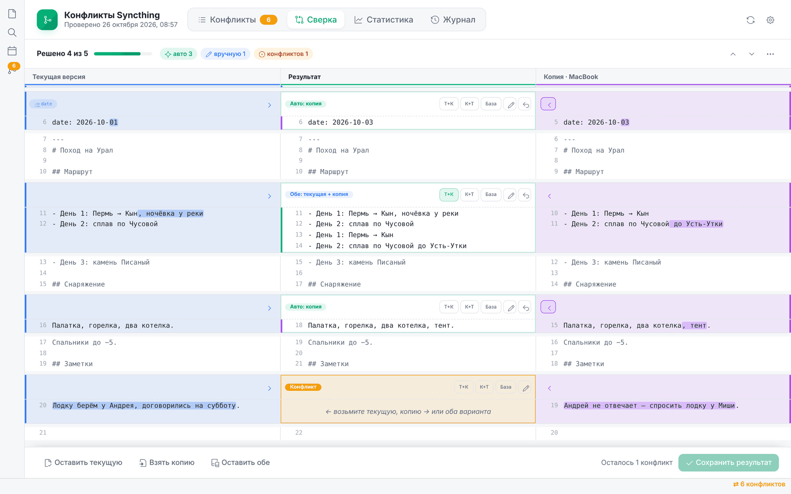

Как решить блок:

- **›** у левой колонки — взять текущую версию;
- **‹** у правой колонки — взять копию;
- **Т+К** / **К+Т** — оставить обе в нужном порядке;
- **База** — вернуть как было до конфликта;
- ✎ — поправить результат руками;
- ↺ — сбросить решение.

Вверху показан прогресс «Решено N из M». Стрелки ˄ ˅ переходят между нерешёнными конфликтами, меню ⋯ решает все оставшиеся разом. Когда оранжевых блоков не останется, нажмите **Сохранить результат**: файл перезапишется, копия уйдёт в корзину. Если у файла есть ещё копии, сразу откроется следующая.

Кнопки внизу работают с файлом целиком: **Оставить текущую**, **Взять копию**, **Оставить обе** (копия сохранится рядом под именем `заметка (Pixel 8 2026-10-25 19-10).md`).

**Свойства (frontmatter)** сливаются по ключам: каждое свойство — отдельный блок с меткой ключа (`tags`, `date`…).

**Без базы** (версионирование выключено) сверка двусторонняя: каждое отличие решается вручную.

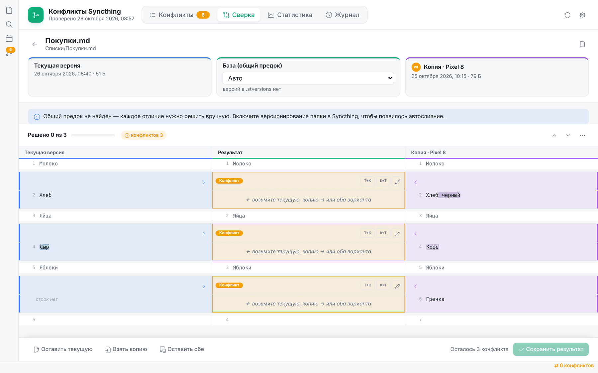

**Тёмная тема** подхватывается из Obsidian:

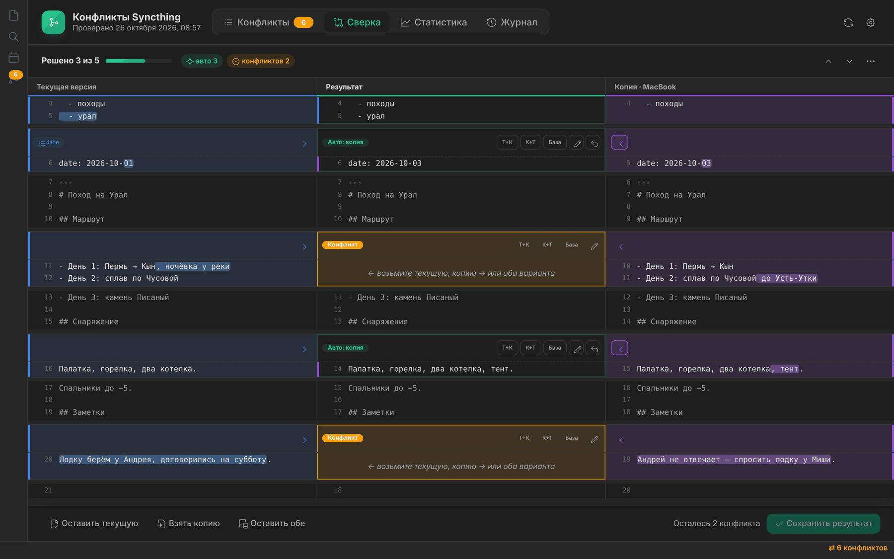

## Картинки и удалённые файлы

Картинки и другие двоичные файлы сравниваются целиком: можно оставить текущую версию, взять копию или сохранить обе.

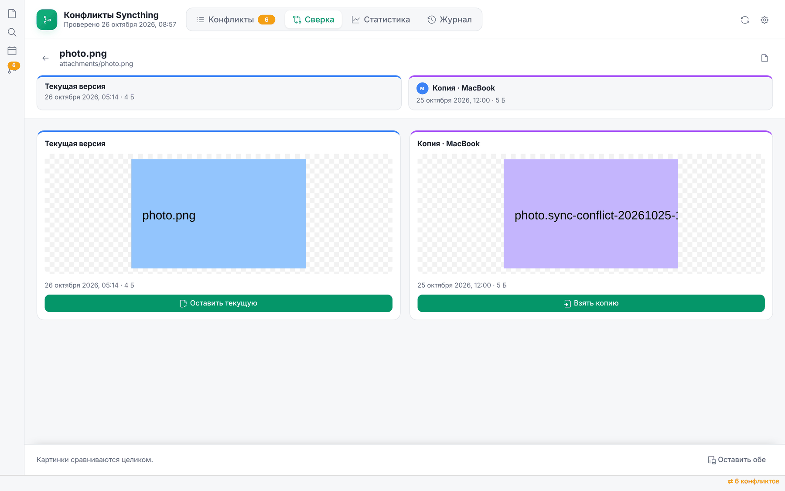

Если исходный файл удалили или переименовали на одном устройстве, а на другом изменили, остаётся только копия. Её можно **восстановить** под исходным именем или **удалить**.

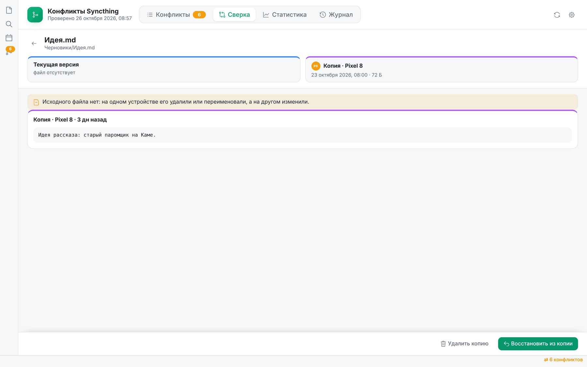

## Статистика и журнал

Вкладка **Статистика** копит данные с момента установки: каждую найденную конфликтную копию и каждое решение. Период можно выбрать: 7, 30, 90 дней или всё время.

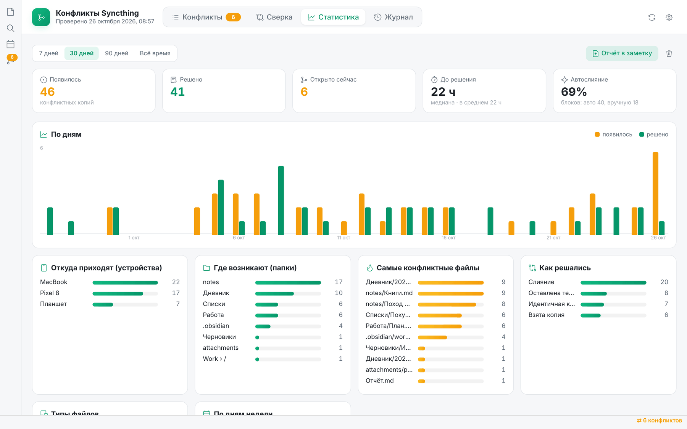

- **Появилось / Решено / Открыто сейчас** — общий счёт.
- **До решения** — медиана и среднее время от появления копии до её решения.
- **Автослияние** — доля блоков, которые слились без вашего участия.
- **По дням** — сколько конфликтов появилось и сколько решено.
- Разбивки **по устройствам, папкам, файлам, способам решения, типам файлов и дням недели**. Клик по файлу открывает его.

Кнопка **«Отчёт в заметку»** (или команда «Сохранить отчёт статистики в заметку») записывает сводку таблицами в `Syncthing/Статистика конфликтов.md`. Путь меняется в настройках.

Во вкладке **Журнал** лежит хронология решений: что сделано, с какого устройства пришла копия и через сколько её разобрали.

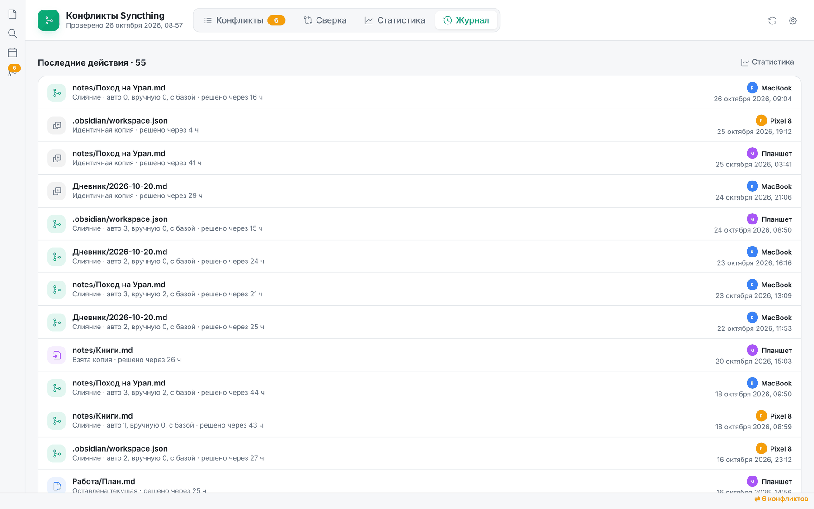

## Папки на устройстве

Кроме хранилища плагин может проверять любые другие папки Syncthing. Их список задаётся в **Настройки → Syncthing Conflict Resolver → Папки на этом устройстве**.

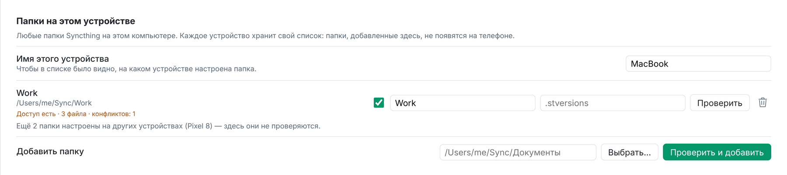

- **Проверить и добавить** — плагин сначала проверит доступ и посчитает файлы и конфликты, и только потом добавит папку.
- **Проверить** — повторная проверка: «Доступ есть · 3 файла · конфликтов: 1» или текст ошибки («Папка не найдена», «Нет доступа…»).
- Флажок включает и выключает проверку папки, не удаляя её из списка.
- Второе поле — папка версий (`.stversions`) для автослияния.
- Команда **«Проверить папки на устройстве»** перепроверяет всё сразу.

**У каждого устройства свой список.** Настройки плагина синхронизируются, но папка, добавленная на Mac, на телефоне не проверяется (и наоборот). Внизу раздела написано, сколько папок настроено на других устройствах.

| Платформа | Что можно |
|---|---|
| **Компьютер** | Любые папки, есть кнопка «Выбрать…» |
| **Android** (экспериментально) | Путь вида `/storage/emulated/0/Syncthing/Документы`. Нужен доступ Obsidian ко всем файлам: Настройки Android → Приложения → Obsidian → Разрешения. Корзины на телефоне нет, поэтому убранные копии кладутся в `.sync-conflict-trash` внутри папки |
| **iPhone / iPad** | iOS не пускает приложения за пределы хранилища. Откройте нужную папку как отдельное хранилище и включите в нём плагин, а `.obsidian` добавьте в `.stignore` этой папки |

## На телефоне

На узком экране колонки сверки складываются в стопку: **текущая → копия → результат**. У каждого блока есть кнопки «Взять». Неактивные вкладки сворачиваются до иконок.

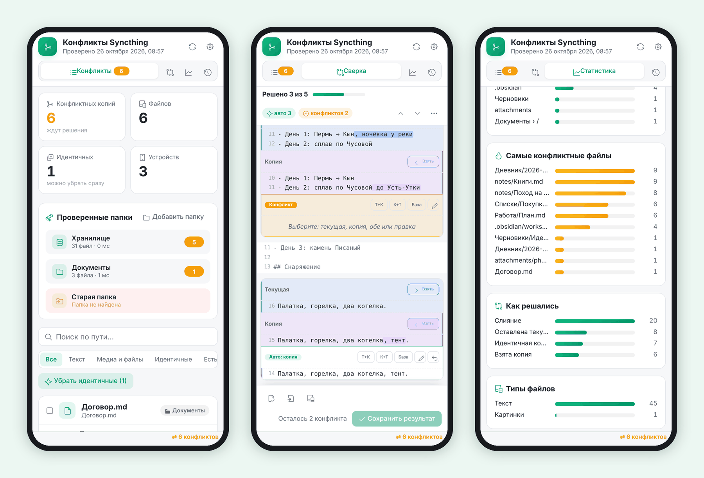

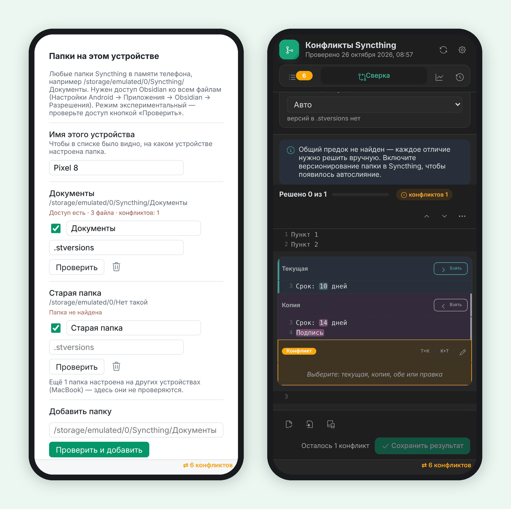

## Настройки

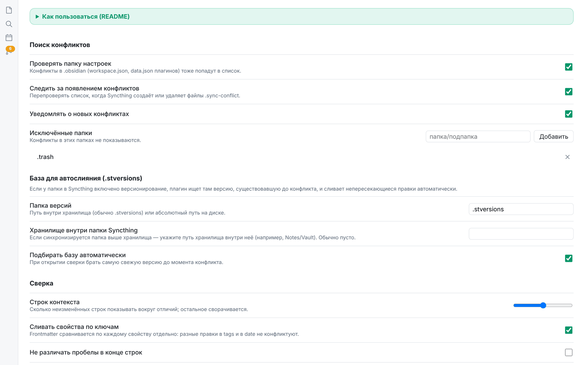

| Раздел | Что настраивается |
|---|---|
| **Поиск конфликтов** | Проверять ли `.obsidian`; следить ли за новыми конфликтами; уведомления; исключённые папки (с автодополнением) |
| **База для автослияния** | Папка версий (`.stversions` или абсолютный путь на компьютере); путь хранилища внутри папки Syncthing; автовыбор базы |
| **Сверка** | Сколько строк контекста показывать; слияние свойств по ключам; игнорировать пробелы в конце строк; куда девать копию: корзина Obsidian, системная корзина или удалять насовсем |
| **Устройства** | Адрес и API-ключ Syncthing, кнопка «Загрузить имена»; ручные имена для ID устройств |
| **Статистика** | Путь заметки с отчётом |
| **Папки на этом устройстве** | Имя устройства, список папок, проверка доступа |

Этот README открывается и прямо в настройках плагина: блок «Как пользоваться (README)» вверху.

## Откуда берётся база

У Syncthing нет общего предка, как в git. Он оставляет только две версии: исходный файл и `.sync-conflict-…`. Чтобы появилась третья, включите для папки хранилища **версионирование** (Syncthing → папка → Изменить → Версионирование → «Простое» или «Поэтапное»). Тогда старые версии будут складываться в `.stversions`.

Плагин сам выбирает самую свежую версию, сохранённую до момента конфликта. Это эвристика. Если база совпала с одной из сторон, появится предупреждение. Тогда базу можно выбрать вручную в шапке сверки или отключить («Без базы — двустороннее»).

Если в Syncthing синхронизируется папка выше хранилища, укажите в настройках путь хранилища внутри неё (например, `Notes/Vault`), иначе версии не найдутся.

## Частые вопросы

**Плагин не видит конфликты.** Нажмите ⟳ в шапке окна. Проверьте, что папка с конфликтом не попала в «Исключённые папки».

**Почему всё «Конфликт», а не «Авто»?** Базы нет: версионирование в Syncthing выключено, или в `.stversions` нет подходящей версии. См. [Откуда берётся база](#откуда-берётся-база).

**Копии есть, а исходного файла нет.** Чаще всего его переименовали или удалили на другом устройстве (см. «Переименованные файлы» выше). Плагин сам найдёт переименованный файл. Если не нашёл, копия будет в категории «Нет исходного файла»: восстановите её, если файл удалили по ошибке, или удалите копию.

**Куда делась конфликтная копия?** В корзину Obsidian (`.trash`), в системную корзину или удалена — смотря что выбрано в настройках. Для папок на Android — в `.sync-conflict-trash` внутри папки.

**Вместо ID устройства хочу видеть имя.** Настройки → Устройства: впишите имя вручную или вставьте API-ключ Syncthing и нажмите «Загрузить имена».

**Что-то сломалось.** Откройте консоль (`Cmd/Ctrl + Option/Shift + I` → Console) и найдите строки с `[Syncthing Conflict Resolver]`.

## Устройство кода

```
main.js                  собранный плагин: все модули src/ внутри (генерируется, не править руками)
src/plugin.js            ядро: настройки, сканирование, лента, команды, события
src/constants.js         регулярки имён, настройки по умолчанию
src/util.js              даты, пути, размеры
src/journal.js           журнал действий
src/stats.js             статистика: обнаружение, время до решения, ряды по дням
src/settings.js          вкладка настроек (с этим README)
src/core/diff.js         diff Майерса построчно и пословно
src/core/merge.js        двух- и трёхстороннее слияние, свойства по ключам
src/core/classify.js     категории конфликтов: идентичные, невидимые отличия, свойства, расширения, автослияние
src/io/sources.js        хранилище, папки на компьютере (Node fs) и на Android
src/io/scanner.js        поиск конфликтов и версий .stversions
src/io/actions.js        сохранить / оставить / взять / обе
src/io/bulk.js           массовый анализ и пакетные действия по категориям
src/io/syncthing-api.js  имена устройств через REST API Syncthing
src/ui/view.js           окно-вкладка
src/ui/list-tab.js       вкладка «Конфликты»
src/ui/bulk-panel.js     панель «Умный разбор»
src/ui/merge-tab.js      вкладка «Сверка»
src/ui/merge-session.js  состояние одной сверки
src/ui/stats-tab.js      вкладка «Статистика»
src/ui/journal-tab.js    вкладка «Журнал»
src/ui/dom.js            кнопки, карточки, подтверждения
tools/build-single.js    сборка main.js из src/: node tools/build-single.js
screenshots/             картинки для этого README
```

Правки делаются в `src/`, после них нужно пересобрать `main.js` командой `node tools/build-single.js`. Нужен только Node.js, зависимостей нет.

Скриншоты сняты на демонстрационных данных.
